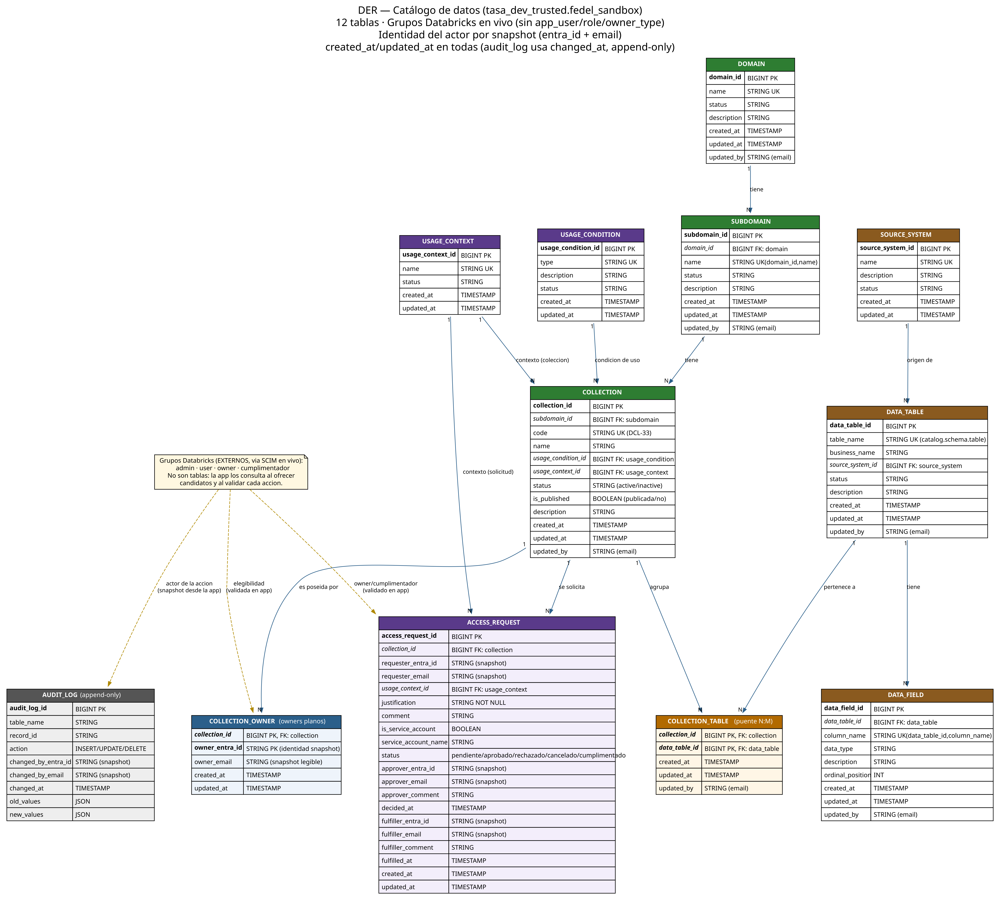

# DER — Catálogo de datos (`tasa_dev_trusted.fedel_sandbox`)

Diagrama entidad-relación del catálogo de datos. **12 tablas**, grupos de Databricks
consultados en vivo vía SCIM (sin tablas `app_user` / `role` / `owner_type`), con la
identidad del actor guardada por **snapshot** (`entra_id` + `email`) en cada fila.



## Archivos

| Archivo | Descripción |
|---|---|
| [`der_catalogo.png`](der_catalogo.png) | Diagrama en alta resolución (7040×6328). |
| [`der_catalogo_web.png`](der_catalogo_web.png) | Versión intermedia (~690 KB). |
| [`der_catalogo_small.png`](der_catalogo_small.png) | Versión liviana (~160 KB). |
| [`der_catalogo.svg`](der_catalogo.svg) | Versión vectorial (escala sin perder calidad). |
| [`der.dot`](der.dot) | **Fuente** Graphviz (editable). |
| [`der_catalogo.mmd`](der_catalogo.mmd) | Versión Mermaid (`erDiagram`). |

## Convenciones del modelo

- **12 tablas.** Grupos Databricks en vivo (`admin · user · owner · cumplimentador`).
- Identidad del actor por **snapshot** (`<actor>_entra_id` + `<actor>_email`).
- `created_at` / `updated_at` en todas las tablas.
- `AUDIT_LOG` es **append-only** y usa `changed_at`.
- Nota de autoría: la relación de `updated_by` y los snapshots `*_entra_id / *_email`
  se resuelven contra los grupos externos (SCIM) — documentado con una única nota en el
  diagrama en lugar de una flecha por tabla, para reducir ruido visual.

## Regenerar el diagrama

El `der.dot` es la fuente. Para renderizarlo:

```bash
# Con Graphviz nativo (recomendado):
dot -Tpng der.dot -o der_catalogo.png
dot -Tsvg der.dot -o der_catalogo.svg

# Sin Graphviz nativo (Node + WASM):
npm install @hpcc-js/wasm-graphviz sharp
node -e "import('@hpcc-js/wasm-graphviz').then(async ({Graphviz})=>{const g=await Graphviz.load();require('fs').writeFileSync('der_catalogo.svg',g.dot(require('fs').readFileSync('der.dot','utf8')));})"
```

> Nota: en `der.dot` las FK usan `FK: <tabla>`. Si lo abrís con Graphviz nativo podés
> cambiar `:` por `→` para la flecha Unicode (el rasterizador WASM no tiene ese glifo).
